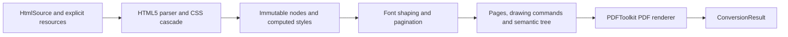

# Architecture

[English](architecture.md) · [Français](fr/architecture.md)

`Converter` creates a fresh pipeline for each document. The conversion result is
an immutable value containing bytes, page count and diagnostics. It holds no DOM
or open resource. File/network access remains the caller's responsibility.

| Layer | Responsibility |
|---|---|
| `Parsing`, `Css` | Bound input, parse HTML5 and CSS, apply cascade and construct typed styles. |
| `Model`, `Style` | Immutable source identities, content and computed values, independent of PDF objects. |
| `Font` | Explicit static TrueType faces, GSUB/GPOS shaping, metrics and variant selection. |
| `Layout` | Widths, line boxes, fragmentation, page positions and semantic identities. |
| `Drawing` | Typed text, image and rectangle operations, expressed in PDF points from the top left. |
| `Rendering` | Document-local font embeddings, marked content, structure/parent trees, images and links through the PDF core. |
| `Resource` | Exact caller-provided catalog lookup and cumulative resource budgets. |

Text command coordinates refer to the baseline. Rendering converts top-left
coordinates to PDF page coordinates. Layout measures shaped advances; painting
uses the same shaping engine. Embedding collects the used repertoire once per
face and per document. Fonts and images may be reused as immutable inputs, while
PDF resource numbers and MCIDs belong to one output document.

Logical structure is distinct from paint order. A single semantic node can refer
to content on several pages. Backgrounds and borders are artifacts; text/images
carry marked-content references and links additionally carry annotation object
references. The original semantic hierarchy is not inferred from painted pixels.

Masterminds HTML5, Sabberworm CSS Parser and Symfony CssSelector handle language
syntax. PDFToolkit's stable core, Fonts, Images and OpenType modules handle PDF
objects, shaping and raster embedding. No iText implementation code is used.

Extensions should add typed values, a bounded algorithm, negative tests and an
independent observable witness before changing the coverage matrix. A renderer
option cannot substitute for a missing layout algorithm.
