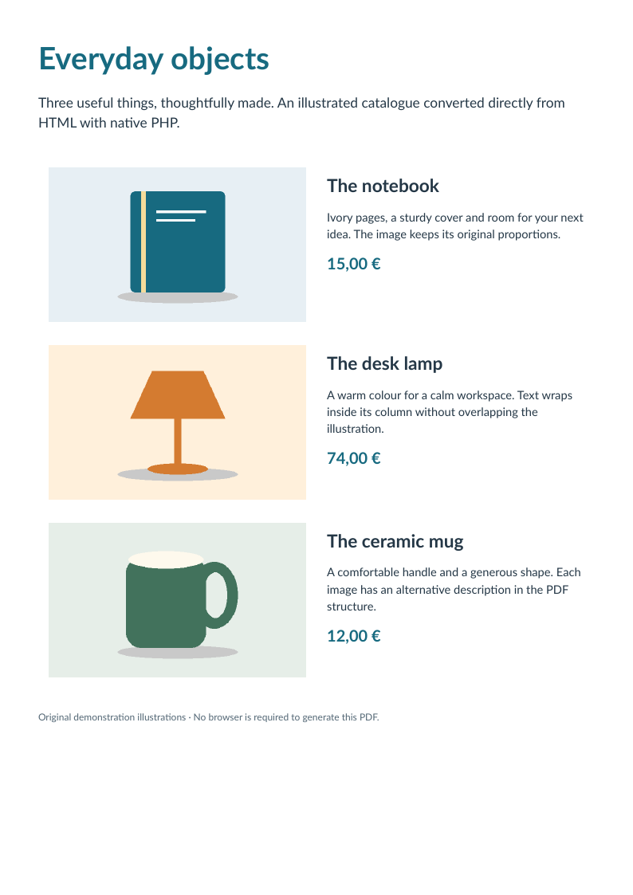

# Catalogue: images beside wrapped text

[English](catalogue.md) · [Français](fr/catalogue.md)

Three original product illustrations sit beside descriptions in a fixed two-column table. Image proportions, cell padding and wrapped text remain visible on one page.



The oracle checks all source text, three embedded images and three Figure elements with alternative descriptions. These are original geometric illustrations, not images copied from the iText comparison.

[HTML source](../examples/sources/catalogue.html) · [PDF download](https://github.com/PDFToolkit/html-to-pdf/releases/download/v0.2.0/catalogue.pdf)

```sh
php -d memory_limit=512M examples/generate.php _build/examples
python tools/validate_pdf.py --directory _build/examples
```

This example illustrates the [documented profile](coverage.md), not a complete CSS level or PDF/UA certification.
