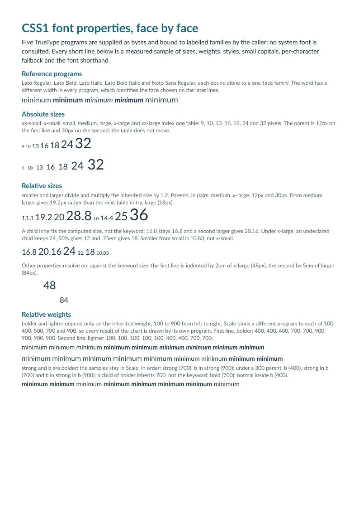
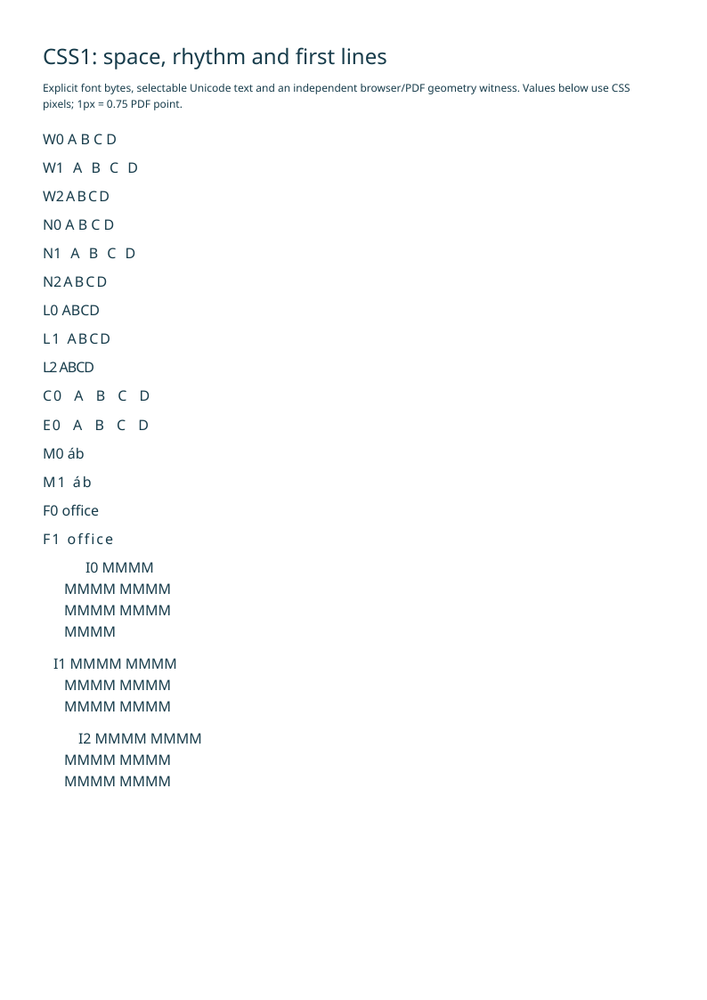
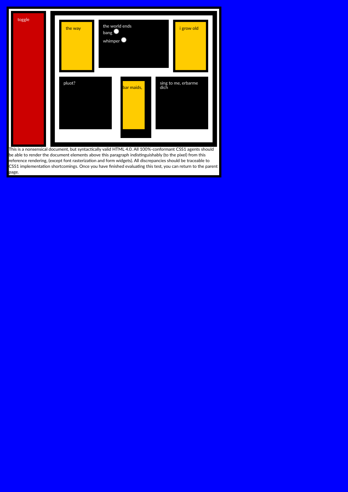
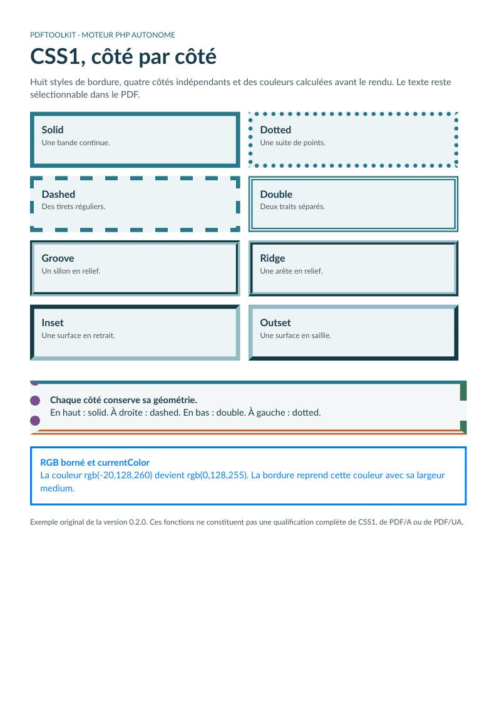

# CSS1: fonts, text spacing, floats and borders

[English](css1.md) · [Français](fr/css1.md)

## Font properties

Version 0.5 works through the six CSS1 font properties and the font matching of
section 5.2.1: absolute and relative size keywords, the nine weights with
`bolder` and `lighter`, `italic` and `oblique`, `small-caps`, the `font`
shorthand, matching across the family list and fallback character by character.
The [usage guide](usage.md#explicit-font-families) describes labeled faces, the
matching steps, the informational diagnostics and the limits.

[HTML source](../examples/sources/fonts.html) ·
[Font bindings](../examples/sources/fonts.json) ·
[Generator](../examples/generate-fonts.php)



```css
body { margin: 0; font: 14px/20px Lato, "Noto Sans"; color: #1d3340; }
.larger { font-size: larger; }
.bolder { font-weight: bolder; }
.oblique { font-style: oblique; }
.caps { font-variant: small-caps; }
.inherited { font: italic small-caps bold 25px/50px Ladder; }
```

The example supplies five TrueType programs, four Lato faces and Noto Sans
Regular, and binds them to families labeled by the caller. The families Ladder,
Scale, Slant and Engraved deliberately give a program an unusual label, so that
each possible answer of a rule is drawn by a different program and the chosen
face can be read from glyph advances alone. Its 31 measured lines hold 130 short
samples without kerning or ligatures. The manifest records the hashes of the
source, the bindings and every font file.

```sh
php -d memory_limit=512M examples/generate-fonts.php _build/fonts
node tools/validate_fonts.cjs _build/fonts/browser
python tools/validate_fonts.py --pdf _build/fonts/fonts.pdf \
  --manifest _build/fonts/manifest.json \
  --browser-report _build/fonts/browser/browser-report.json \
  --output _build/fonts/pdf
python tools/test_fonts_oracle.py
node tools/test_fonts_oracle.cjs
```

Install the pinned Python dependencies in `tools/validation-requirements.txt`,
qpdf, Poppler and the browsers shown below. The PDF oracle finds `qpdf`,
`pdftotext` and `pdftoppm` on the `PATH`, or through its `--qpdf`, `--pdftotext`
and `--pdftoppm` options.

Expected values are derived twice, in JavaScript and in Python, from CSS1 5.2,
CSS 2.1 15 and the font tables; neither oracle reads the converter sources. The
browser oracle compares computed values, sample positions, widths and the face
each browser chose. The PDF oracle identifies every embedded program against the
supplied files, then checks the face, size, glyph identifiers, advances, position
and Unicode text of each fragment, the informational diagnostics and the presence
of ink at each sample. Values inside the PDF are compared within 0.000001pt;
widths and positions against the browsers within 0.09pt and 0.225pt. Both oracles
refuse to run when the bindings no longer separate the standard from rival rules
such as nearest weight. Their negative controls reject every deliberately wrong
observation.

Seven deviations are asserted instead of hidden; an oracle fails if one of them
disappears. The first is shared with both browsers and departs from a CSS1
example; the six others are differences from the browser witnesses:

- `larger` and `smaller` scale the inherited size by 1.2, in the converter and in
  both browsers. The CSS1 example where `larger` from `medium` equals `large` is
  not reproduced.
- A family without a face of the requested style is skipped, as CSS1 5.2.1 and
  CSS 2.1 15.2 require. Both browsers stay in the first family.
- Faces labeled italic and oblique stay distinct, as in one browser. The other
  matches them as one set.
- Small capitals are synthesized at 0.8 of the font size, as in one browser. The
  other uses 0.7.
- A face labeled as a small-caps font is drawn as written. `@font-face` has no
  such label, so both browsers synthesize from the other faces of the family.
- The OpenType `smcp` feature is not used. Both browsers draw the small-capital
  glyphs of a font that has them.
- `line-height: normal`, restored by the `font` shorthand, is 4/3 of the font
  size. Both browsers derive it from the font metrics, and CSS1 5.4.8 only
  suggests a value between 1.0 and 1.2.

The oracle does not cover vertical metrics beyond the distance between two
baselines, kerning and ligatures across browsers, a default family with several
faces, the `font.cluster-split` and `font.small-caps-fallback` diagnostics, or
browser pagination. No bold, italic or oblique is synthesized; `font-size: 0`,
the `ex` unit and a missing-character symbol remain unsupported. These selected
observations do not qualify the font properties in every CSS1 context.

## Text spacing and first-line indentation

Version 0.4 adds `word-spacing`, `letter-spacing` and `text-indent` to the native
PHP layout. These properties accept signed supported lengths and inherit their
computed values. Spacing also accepts `normal`; indentation additionally accepts
percentages. The [usage guide](usage.md#text-spacing-and-first-line-indentation)
describes their values and limits.

[HTML source](../examples/sources/text-spacing.html) ·
[Generator](../examples/generate-text-spacing.php)



```css
p { word-spacing: 2px; letter-spacing: .05em; text-indent: 10%; }
p.tight { word-spacing: -1px; letter-spacing: -.02em; text-indent: -12px; }
```

The example uses explicitly supplied Noto Sans and includes positive/negative
spacing, nonbreaking spaces, inherited `em` lengths, combining marks, ligatures
and first-line indentation. It also exercises a paragraph continuing onto a new
PDF page. Its source and font hashes are recorded in the generation manifest.

```sh
php -d memory_limit=512M examples/generate-text-spacing.php _build/text-spacing
node tools/validate_text_spacing.cjs _build/text-spacing/browser
python tools/validate_text_spacing.py --pdf _build/text-spacing/text-spacing.pdf \
  --manifest _build/text-spacing/manifest.json \
  --browser-report _build/text-spacing/browser/browser-report.json \
  --output _build/text-spacing/pdf
python tools/test_text_spacing_oracle.py
node tools/test_text_spacing_oracle.cjs
```

Install the pinned Python dependencies in `tools/validation-requirements.txt`,
qpdf, Poppler and the browsers shown below. Independent checks cover PDF glyph
positions and Unicode mappings, annotation bounds, browser text geometry and
rendered pages. Browser witnesses measure continuous-page geometry; they do not
establish equivalence with browser print pagination.

The implemented letter-spacing convention adds an advance after each grapheme,
including the final grapheme of a run, as witnessed in Chromium and Firefox.
There is no added space between a base character and its combining marks.
`normal` and explicit zero retain identical shaping; nonzero letter spacing
suppresses optional ligatures. These selected observations do not claim complete
CSS Text module support. Text stays selectable and the same adjusted advances
serve line breaking, drawing, decorations and link annotations.

The percentage indent uses the content width of the block containing the lines,
not a line's temporary width beside a float. The indent is not restarted by a
`br`, page break or later anonymous inline fragment after an in-flow child block.
A descendant block has its own first-line rule. Text transformation, justification
and the remaining decoration contexts are still pending.
An excessive negative spacing that produces a negative total run advance is
rejected explicitly. Preserved tabs with nonzero letter or word spacing also
raise `UnsupportedFeature`; normal-spacing tabs retain their existing profile,
without claiming exact CSS tab-stop placement.

## Historical box / float / clear example

Version 0.3 renders the unchanged
[historical source](https://www.w3.org/Style/CSS/Test/CSS1/current/test5526c.htm)
with the native PHP engine. It combines left/right and nested floats, percentage
widths, fixed heights, asymmetric borders, list-marker suppression, clearance,
root backgrounds and a font shorthand. The two radios are explicit static snapshots.



[Unmodified bundled HTML](../resources/css1/w3c/test5526c.htm) ·
[Generator](../examples/generate-w3c.php) ·
[Source hashes and provenance](../resources/css1/w3c/provenance.json) ·
[BSD fixture notice](../resources/css1/w3c/NOTICE)

The generator supplies Lato as the explicit `sans-serif` binding, uses A4 with
zero additional page margins, and keeps the HTML's own margins. It provides the
source URL only as a base for annotation links; no URL is fetched. The source's
Verdana family is unavailable in this catalog, so its declared generic fallback
selects Lato. Font rasterization and exact line wrapping can differ from browsers.

```sh
php -d memory_limit=512M examples/generate-w3c.php _build/w3c
python tools/validate_w3c_css1.py --pdf _build/w3c/test5526c.pdf \
  --manifest _build/w3c/manifest.json --output _build/w3c/validation
npm ci --prefix tools
npm exec --prefix tools -- playwright install chromium firefox
node tools/validate_w3c_css1.cjs _build/w3c/browsers
python tools/test_w3c_css1_oracle.py
node tools/test_w3c_css1_oracle.cjs
```

Python dependencies are pinned in `tools/validation-requirements.txt`; qpdf and
Poppler are also required. The browser oracle checks 50 box coordinates and 13
computed properties in each engine from identical source bytes, at 96 CSS px per
inch. The PDF oracle checks source/PDF hashes, one exact A4 page, qpdf syntax,
selectable source text through explicit CMaps and Poppler, clearance/text bounds,
and independent color masks at 96 dpi. Edge antialiasing has a 1.25 px exclusion;
color channels tolerate 4/255, with at most 0.2% mismatches per color. Font/widget
areas and the font-dependent footer band are excluded from that raster mask;
text content and paragraph clearance have separate checks.

This selected historical case does **not** qualify the whole test suite or CSS1.
Floats require explicit widths and a one-page document; float pagination,
float/table combinations and parent-child margin collapse in float contexts remain
unsupported. Decorated normal-flow blocks overlapping earlier floats and floats
introduced after text on the same line are also rejected. See
[coverage](coverage.md) and [usage](usage.md) for those boundaries.

## Independent border sides

Version 0.2 adds four independent border sides and eight visible border styles.
This original example presents `solid`, `dotted`, `dashed`, `double`, `groove`,
`ridge`, `inset` and `outset`, followed by a box with a different style, width and
color on each side. Text remains selectable; borders are PDF artifacts.



[HTML source](../examples/sources/css1.html) · [Generator](../examples/generate.php) ·
[PDF download for v0.2.0](https://github.com/PDFToolkit/html-to-pdf/releases/download/v0.2.0/css1.pdf)

```css
.sides {
    border-top: 4pt solid #26788b;
    border-right: 8pt dashed #3b7557;
    border-bottom: 6pt double #ba5e24;
    border-left: 12pt dotted #78508e;
}
.rgb {
    color: rgb(-20,128,260);
    border: medium solid;
}
```

The last box clips RGB components to `rgb(0,128,255)`. Its omitted border color
uses `currentColor`. This package chooses `medium = 3px = 2.25pt`; `thin` and
`thick` use 1px and 5px. These numeric widths are implementation choices. `none`
uses no geometric border width; a transparent border with a visible style keeps
its width. Inline border decoration and collapsed table borders remain unsupported.

The release also validates original declaration values before cascade. In Report
mode an invalid later value cannot erase an earlier valid value, and an invalid
shorthand cannot partially alter its sides. Ordered, bounded imports from an
explicit catalog and escaped selector identifiers are covered in the
[usage guide](usage.md). This visual example concentrates on the border/color
subset; it is not evidence for every parser or import case.

To regenerate all examples and inspect their output:

```sh
php -d memory_limit=512M examples/generate.php _build/examples
python tools/validate_pdf.py --directory _build/examples
```

The release evidence includes independent PDF checks, every page render and
Chromium/Firefox witnesses for selected computed styles and box geometry. It
identifies the exact candidate and tool versions. A preview alone does not prove
browser/PDF equivalence or accessibility certification.

The [coverage registry](../resources/css-coverage.json) records 54 partial and
8 unsupported requirements. **CSS1 remains incomplete**, with further text/font work
remaining in the [qualification sequence](css-levels.md). No PDF/A or PDF/UA claim is made.
