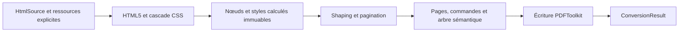

# Architecture

[English](../architecture.md) · [Français](architecture.md)

`Converter` crée une chaîne de traitement neuve pour chaque document. Le résultat
immuable contient les octets, le nombre de pages et les diagnostics, sans DOM ni
ressource ouverte. Les accès aux fichiers et au réseau appartiennent à l’appelant.

| Couche | Responsabilité |
|---|---|
| `Parsing`, `Css` | Borner l’entrée, analyser HTML5/CSS, calculer la cascade et les styles typés. |
| `Model`, `Style` | Identités, contenu et valeurs calculées immuables, indépendants des objets PDF. |
| `Font` | Polices TrueType statiques explicites, shaping GSUB/GPOS, métriques et variantes. |
| `Layout` | Largeurs, lignes, fragmentation, positions et identités sémantiques. |
| `Drawing` | Commandes typées de texte, image et rectangle en points depuis le coin supérieur gauche. |
| `Rendering` | Incorporations de polices propres au document, contenu balisé, arbres de structure/parents, images et liens via le cœur PDF. |
| `Resource` | Recherche exacte dans le catalogue fourni et budgets cumulés. |

Les coordonnées du texte désignent la ligne de base ; l’écriture les convertit
dans le repère PDF. La mise en page mesure les avances des glyphes après shaping,
avec le même moteur que le rendu. Le répertoire est incorporé une fois par
variante et par document. Les entrées immuables sont réutilisables ; numéros de
ressources PDF et MCID appartiennent à une seule sortie.

La structure logique est distincte de l’ordre de peinture. Un nœud sémantique
peut référencer plusieurs pages. Fonds et bordures sont des artefacts ; textes et
images ont des références de contenu balisé, les liens ont aussi une référence
vers l’annotation. La hiérarchie ne se déduit pas des pixels dessinés.

Masterminds HTML5, Sabberworm CSS Parser et Symfony CssSelector traitent les
syntaxes. Les versions stables des modules Core, Fonts, Images et OpenType de
PDFToolkit assurent objets PDF, shaping et incorporation. Aucun code iText n’est repris.

Chaque extension doit apporter valeurs typées, algorithme borné, tests négatifs
et preuve observable indépendante avant de modifier la matrice de couverture.
Une option de rendu ne remplace pas un algorithme de mise en page absent.
