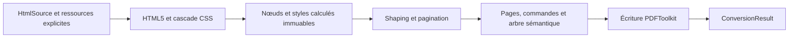

# Architecture

[English](../architecture.md) · [Français](architecture.md)

`Converter` crée une chaîne de traitement neuve pour chaque document. Le résultat
immuable contient les octets, le nombre de pages et les diagnostics, sans DOM ni
ressource ouverte. Les accès aux fichiers et au réseau appartiennent à l’appelant.

| Couche | Responsabilité |
|---|---|
| `Parsing`, `Css` | Borner l’entrée, analyser HTML5/CSS, calculer la cascade et les styles typés. |
| `Model`, `Style` | Identités, contenu et valeurs calculées immuables, indépendants des objets PDF. |
| `Font` | Polices TrueType statiques explicites, catalogue de familles, shaping GSUB/GPOS, métriques et variantes. |
| `Layout` | Largeurs, lignes, fragmentation, positions et identités sémantiques. |
| `Drawing` | Commandes typées de texte, image, rectangle, boîte de bordures et radio statique en points depuis le coin supérieur gauche. |
| `Rendering` | Incorporations de polices propres au document, contenu balisé, arbres de structure/parents, images et liens via le cœur PDF. |
| `Resource` | Recherche exacte dans le catalogue fourni et budgets cumulés. |

Les coordonnées du texte désignent la ligne de base ; l’écriture les convertit
dans le repère PDF. La mise en page mesure les avances des glyphes après shaping,
avec le même moteur que le rendu. Le répertoire est incorporé une fois par
variante et par document. Les entrées immuables sont réutilisables ; numéros de
ressources PDF et MCID appartiennent à une seule sortie.

La structure logique est distincte de l’ordre de peinture. Un nœud sémantique
peut référencer plusieurs pages. Fonds et bordures sont des artefacts ; textes et
images ont des références de contenu balisé, les liens ont aussi une référence
vers l’annotation. La hiérarchie ne se déduit pas des pixels dessinés.

Masterminds HTML5, Sabberworm CSS Parser et Symfony CssSelector traitent les
syntaxes. Les versions stables des modules Core, Fonts, Images et OpenType de
PDFToolkit assurent objets PDF, shaping et incorporation.

`DeclarationSource` retrouve chaque valeur originale depuis la position fournie
par le parseur CSS et un index UTF-8 borné. `Declarations` la valide et développe
ses raccourcis intégralement avant que `Cascade` applique importance, spécificité
et ordre : la sérialisation du parseur ne peut transformer un nombre malformé en
couleur valide. `SelectorPolicy` inspecte les nœuds des sélecteurs et borne leur
profondeur avant traduction XPath. Toute la liste doit être valide avant effet.

Les imports du catalogue appartiennent au document. `CatalogUri` résout les
identités sans I/O ; le suivi du chemin actif repère les cycles sans supprimer
un nouvel import légitime plus tard. `ParseBudget` compte chaque occurrence
analysée, import et sélecteur. La récupération Report conserve budgets et diagnostics.

`BorderComputer` produit un `Borders` immuable contenant quatre `BorderSide`.
La mise en page utilise leur largeur effective ; `Drawing\BorderBox` et
`Rendering\BorderPainter` conservent la géométrie de la boîte complète lors du
rendu des fragments de pages. Les bordures restent des artefacts. Les anciens
paramètres uniformes restent utilisables ; les nouvelles intégrations doivent
inspecter `ComputedStyle::borderEdges()`.

Chaque extension doit apporter valeurs typées, algorithme borné, tests négatifs
et preuve observable indépendante avant de modifier la matrice de couverture.
Une option de rendu ne remplace pas un algorithme de mise en page absent.

`FontCatalog` résout les listes immuables de familles uniquement dans les noms
et génériques fournis par l’appelant. `FontDeclarations` développe le raccourci
pris en charge avant cascade ; `InlineFormatter` mesure et peint avec les faces appariées.

L’appariement des polices se répartit entre des objets purs et un consommateur à
état. `FamilyFace` porte les étiquettes de l’appelant (style, graisse, variante
petites capitales) et `FontSet` est une famille de telles faces. `FontMatcher`
applique CSS 2.1 15.2 et renvoie une `FaceChain` : les familles listées dont le
style correspond, puis la meilleure correspondance de la famille par défaut,
suivie de ses autres faces en dernier recours pour un caractère qu’aucune ne
possède.
`TextItemizer` découpe un texte en segments `TextSegment` par grappe de graphèmes,
en demandant à chaque face le glyphe qu’elle dessinerait réellement, c’est-à-dire,
pour les petites capitales synthétisées, la capitale que `SmallCapitals` associe à
une lettre. La couverture ne lit que la table de caractères : sonder une face de
repli ne prépare aucune table de façonnage. Aucun de ces objets ne connaît les
diagnostics ni les budgets.

`InlineFormatter` détient l’état limité à la conversion : chaînes par style
calculé, découpages et mesures dans le budget de façonnage, et notes informatives
`font.*`, que `Diagnostics::inform()` enregistre sans jamais interrompre une
conversion. Chaque segment devient une commande `Text` avec sa face et son corps ;
`Text::$capitals` demande au façonneur la mise en capitales tandis que la commande
conserve le texte source. Un segment commence où le précédent se termine, avec
les mêmes avances mesurées que celles de la coupure des lignes, des décorations
et des rectangles de lien. `FontSizes` et `FontWeights` résolvent les mots-clés
pendant le calcul des styles, où une taille, une graisse, un style ou une variante
non déclarés héritent de la valeur calculée elle-même et non d’une forme sérialisée.
`FloatContext`, `LineExclusions` et un `FloatWorkBudget` partagé bornent placement
et exclusion des lignes. `FlowItem::paintHeight` sépare étendue visible et hauteur
de flux ; les documents à flottants sont réunis en un contexte indivisible d’une page.

`HtmlDoctypeProjection` reconnaît les métadonnées Strict historiques prises en
charge sans télécharger de DTD. `HtmlDocument::canvasBackground` sépare fond de
page et décoration du body. Le dessin explicite `RadioButton` devient opérateurs
vectoriels et attributs logiques Form/PrintField, sans champ PDF ni action. Les
oracles indépendants navigateur/PDF du cas historique n’importent pas le modèle
de mise en page PHP.

`TextValues` valide espacements/retraits signés sans affaiblir les longueurs de
boîte non négatives. `TextSpacing` distingue `normal` de zéro tout en héritant
des points calculés ; `TextIndent` conserve les pourcentages signés jusqu’au
calcul du bloc contenant les lignes. Les commandes de texte transmettent les
espacements aux translations et à la pagination. Shaping, mesure, dessin et
annotations de lien partagent les avances ajustées ; seules les valeurs non
nulles d’espacement des lettres désactivent les ligatures facultatives. Les
frontières de graphèmes gardent les accents attachés ; graphèmes inter-fragments
non pris en charge et avances totales négatives échouent explicitement. La
première ligne admissible appartient au flux du bloc ; les fragments suivants
ne recommencent pas son retrait.
