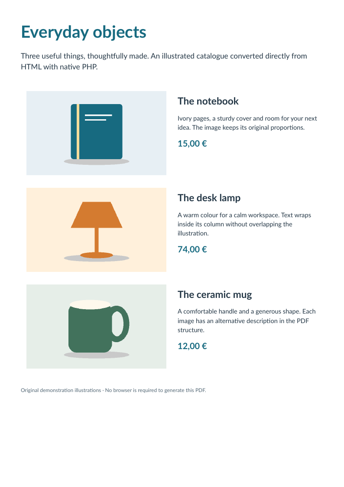

# Catalogue : images et texte en colonnes

[English](../catalogue.md) · [Français](catalogue.md)

Trois illustrations originales accompagnent les descriptions dans un tableau fixe à deux colonnes. Proportions, padding et retours du texte restent visibles sur une page.



L’oracle vérifie tout le texte source, trois images incorporées et trois éléments Figure avec leurs descriptions alternatives. Les illustrations géométriques sont originales et ne proviennent pas du comparatif iText.

[Source HTML](../../examples/sources/catalogue.html) · [Télécharger le PDF](https://github.com/PDFToolkit/html-to-pdf/releases/download/v0.1.0/catalogue.pdf)

```sh
php -d memory_limit=512M examples/generate.php _build/examples
python tools/validate_pdf.py --directory _build/examples
```

Cet exemple illustre le [profil documenté](coverage.md), sans certification d’un niveau CSS complet ni PDF/UA.
