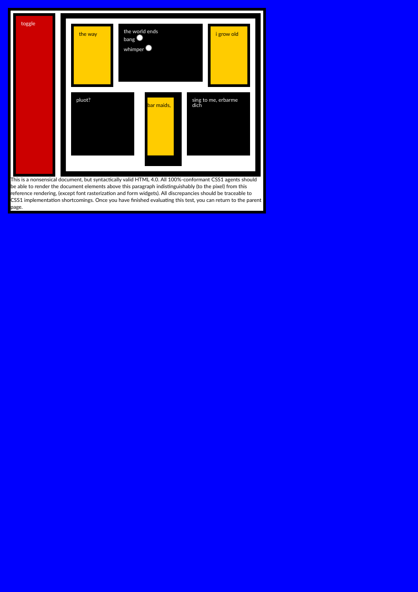
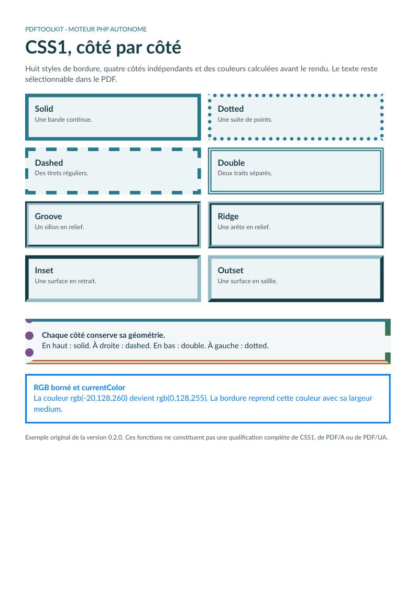

# CSS1 : exemple natif avec flottants et bordures indépendantes

[English](../css1.md) · [Français](css1.md)

## Exemple historique de boîtes, flottants et dégagement

La version 0.3 convertit la
[source historique inchangée](https://www.w3.org/Style/CSS/Test/CSS1/current/test5526c.htm)
avec le moteur PHP natif. Elle combine flottants gauche/droite et imbriqués,
largeurs en pourcentage, hauteurs fixes, bordures asymétriques, suppression des
marqueurs, dégagement, fond racine et raccourci de police. Les deux boutons radio
sont des instantanés statiques explicitement demandés.



[HTML fourni sans modification](../../resources/css1/w3c/test5526c.htm) ·
[Générateur](../../examples/generate-w3c.php) ·
[Empreintes et provenance](../../resources/css1/w3c/provenance.json) ·
[Notice BSD](../../resources/css1/w3c/NOTICE)

Le générateur associe explicitement Lato au générique `sans-serif`, utilise A4
sans marge de page supplémentaire et conserve les marges du HTML. L’URL source
sert seulement de base aux annotations de liens ; aucune URL n’est téléchargée.
Verdana n’étant pas dans le catalogue, le générique déclaré choisit Lato. Le dessin
des glyphes et les retours à la ligne peuvent différer de ceux des navigateurs.

```sh
php -d memory_limit=512M examples/generate-w3c.php _build/w3c
python tools/validate_w3c_css1.py --pdf _build/w3c/test5526c.pdf \
  --manifest _build/w3c/manifest.json --output _build/w3c/validation
npm ci --prefix tools
npm exec --prefix tools -- playwright install chromium firefox
node tools/validate_w3c_css1.cjs _build/w3c/browsers
python tools/test_w3c_css1_oracle.py
node tools/test_w3c_css1_oracle.cjs
```

Les dépendances Python sont figées dans `tools/validation-requirements.txt` ;
qpdf et Poppler sont aussi nécessaires. L’oracle navigateur vérifie 50 coordonnées
et 13 propriétés calculées dans chaque moteur, sur les mêmes octets source à
96 pixels CSS par pouce. L’oracle PDF vérifie empreintes, page A4 exacte unique,
syntaxe qpdf, texte source sélectionnable via CMaps explicites et Poppler,
dégagement/positions du texte et masques de couleurs indépendants à 96 dpi.
Les bords anticrénelés sont exclus sur 1,25 px ; les canaux tolèrent 4/255, avec
au plus 0,2 % d’écarts par couleur. Le masque exclut les zones de texte/contrôles
et la bande finale dépendant des polices ; le contenu textuel et le dégagement
du paragraphe font l’objet de contrôles distincts.

Ce cas historique choisi ne qualifie **ni toute la suite ni CSS1**. Les flottants
exigent une largeur explicite et un document d’une page ; leur pagination,
combinaison avec tableaux et fusion parent-enfant des marges restent absentes.
Les blocs ordinaires décorés chevauchant un flottant antérieur et les flottants
introduits après du texte sur la même ligne sont aussi refusés. La
[couverture](coverage.md) et le [guide](usage.md) précisent ces limites.

## Côtés de bordure indépendants

La version 0.2 ajoute quatre côtés de bordure indépendants et huit styles
visibles. Cet exemple original présente `solid`, `dotted`, `dashed`, `double`,
`groove`, `ridge`, `inset` et `outset`, puis une boîte dont chaque côté possède
son style, sa largeur et sa couleur. Le texte reste sélectionnable ; les
bordures sont des artefacts PDF.



[Source HTML](../../examples/sources/css1.html) · [Générateur](../../examples/generate.php) ·
[PDF de la version 0.2.0](https://github.com/PDFToolkit/html-to-pdf/releases/download/v0.2.0/css1.pdf)

```css
.sides {
    border-top: 4pt solid #26788b;
    border-right: 8pt dashed #3b7557;
    border-bottom: 6pt double #ba5e24;
    border-left: 12pt dotted #78508e;
}
.rgb {
    color: rgb(-20,128,260);
    border: medium solid;
}
```

La dernière boîte borne ses composantes à `rgb(0,128,255)`. La couleur de bordure
omise utilise `currentColor`. Le module choisit `medium = 3px = 2,25pt` ; `thin`
et `thick` utilisent 1px et 5px. Ces dimensions relèvent de l’implémentation.
`none` n’utilise aucune largeur géométrique ; une bordure transparente de style
visible conserve sa largeur. Les bordures inline et les bordures fusionnées de
tableau restent absentes.

La version valide aussi les valeurs originales avant cascade. En Report, une
valeur ultérieure invalide n’efface plus la valeur valide précédente et un
raccourci invalide n’applique aucun côté partiellement. Le [guide](usage.md)
décrit les imports ordonnés et bornés dans un catalogue explicite ainsi que les
identifiants de sélecteurs échappés. Cet exemple visuel se concentre sur les
bordures/couleurs ; il ne démontre pas tous les cas d’analyse ou d’import.

Pour reproduire les exemples et contrôler leurs sorties :

```sh
php -d memory_limit=512M examples/generate.php _build/examples
python tools/validate_pdf.py --directory _build/examples
```

Les preuves de release comprennent les contrôles PDF indépendants, les rendus
de chaque page et les témoins Chromium/Firefox de styles calculés et de géométrie.
Elles identifient le candidat exact et les versions des outils. Un aperçu ne
prouve ni l’équivalence navigateur/PDF ni une certification d’accessibilité.

Le [registre](../../resources/css-coverage.json) compte 49 exigences partielles
et 13 absentes. **CSS1 reste incomplet** ; le texte et les polices constituent la
prochaine étape de la [progression](css-levels.md). Aucune conformité PDF/A ou
PDF/UA n’est annoncée.
