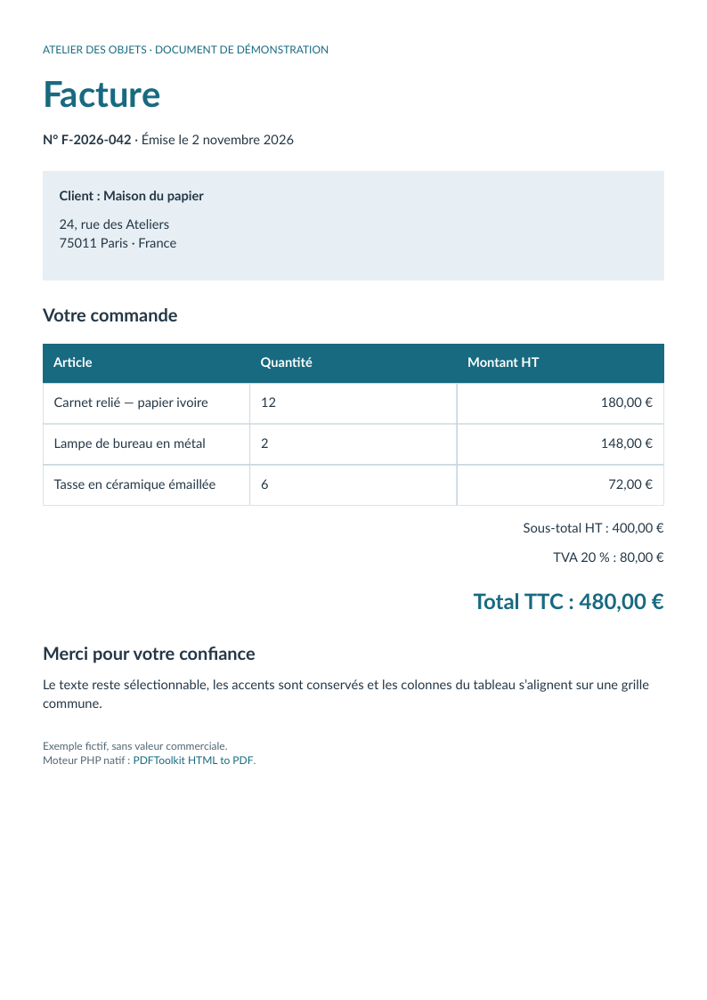

# Facture : texte et colonnes alignées

[English](../invoice.md) · [Français](invoice.md)

Une facture française sur une page : accents, vrai gras, sections colorées, tableau fixe à trois colonnes, montants alignés à droite et lien structuré.



L’oracle indépendant vérifie le montant 480,00 €, l’ordre du texte source, les polices incorporées, les trois en-têtes et l’annotation URI/OBJR. Le document est fictif et sans valeur commerciale.

[Source HTML](../../examples/sources/invoice.html) · [Télécharger le PDF](https://github.com/PDFToolkit/html-to-pdf/releases/download/v0.2.0/invoice.pdf)

```sh
php -d memory_limit=512M examples/generate.php _build/examples
python tools/validate_pdf.py --directory _build/examples
```

Cet exemple illustre le [profil documenté](coverage.md), sans certification d’un niveau CSS complet ni PDF/UA.
