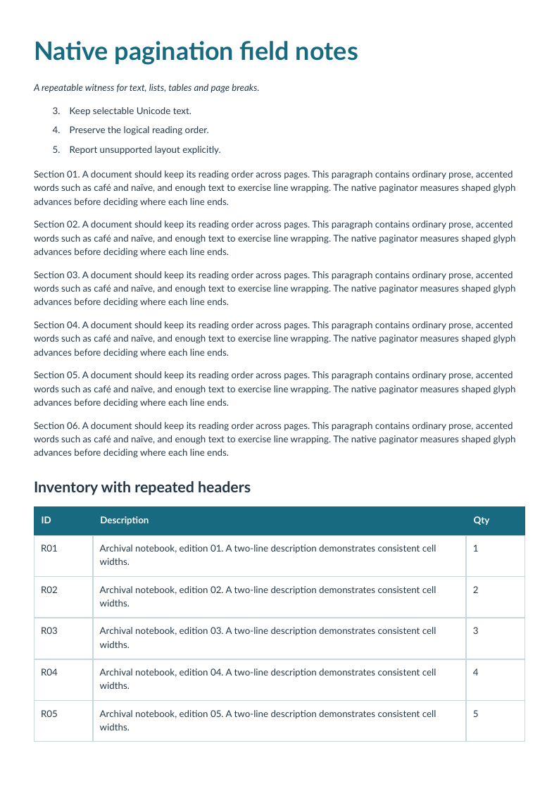

# Plusieurs pages : lignes, ordre et sauts forcés

[English](../multipage.md) · [Français](multipage.md)

Un document de quatre pages combine paragraphes, liste numérotée, trente lignes d’inventaire et saut de page final imposé. Les lignes du tableau restent indivisibles ; les en-têtes répétés deviennent des artefacts après leur première apparition.



L’oracle vérifie les trente références, 31 éléments TR logiques en comptant l’en-tête, trois TH logiques et la conclusion sur la dernière page. Chaque page est rendue et contrôlée pour repérer coupures et pages blanches inattendues.

[Source HTML](../../examples/sources/multipage.html) · [Télécharger le PDF](https://github.com/PDFToolkit/html-to-pdf/releases/download/v0.2.0/multipage.pdf)

```sh
php -d memory_limit=512M examples/generate.php _build/examples
python tools/validate_pdf.py --directory _build/examples
```

Cet exemple illustre le [profil documenté](coverage.md), sans certification d’un niveau CSS complet ni PDF/UA.
