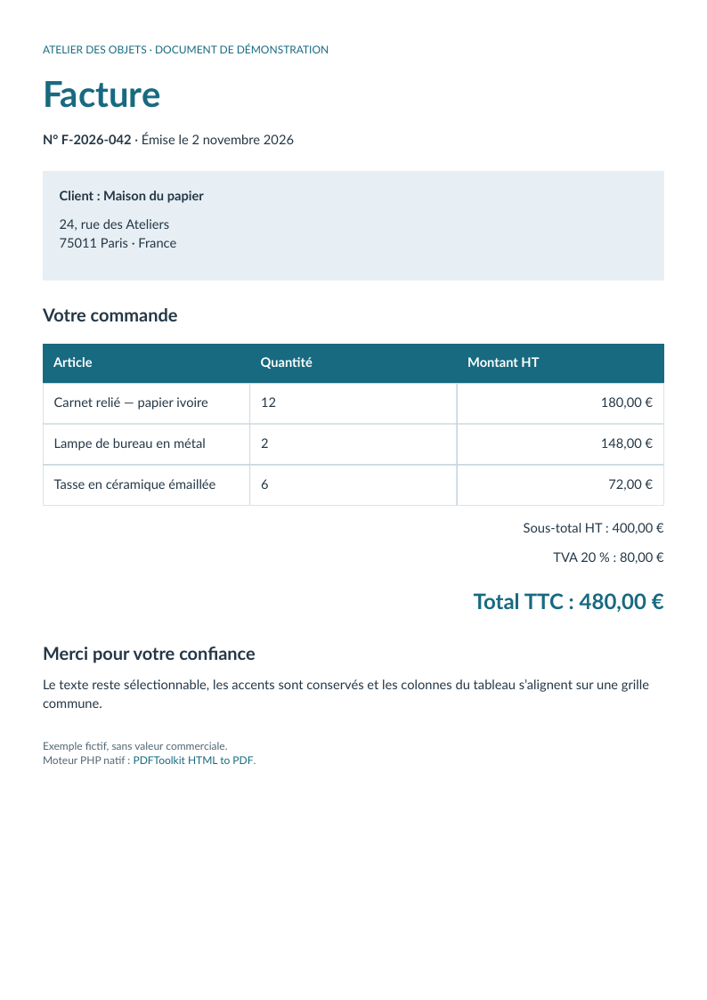

# Invoice: text and aligned columns

[English](invoice.md) · [Français](fr/invoice.md)

A one-page French invoice with accented text, genuine bold faces, colored sections, a fixed three-column table, right-aligned amounts and a structured hyperlink.



The independent oracle checks the amount 480,00 €, source text order, embedded fonts, the three column headers and the URI annotation/OBJR. The illustration is fictitious and has no commercial value.

[HTML source](../examples/sources/invoice.html) · [PDF download](https://github.com/PDFToolkit/html-to-pdf/releases/download/v0.2.0/invoice.pdf)

```sh
php -d memory_limit=512M examples/generate.php _build/examples
python tools/validate_pdf.py --directory _build/examples
```

This example illustrates the [documented profile](coverage.md), not a complete CSS level or PDF/UA certification.
