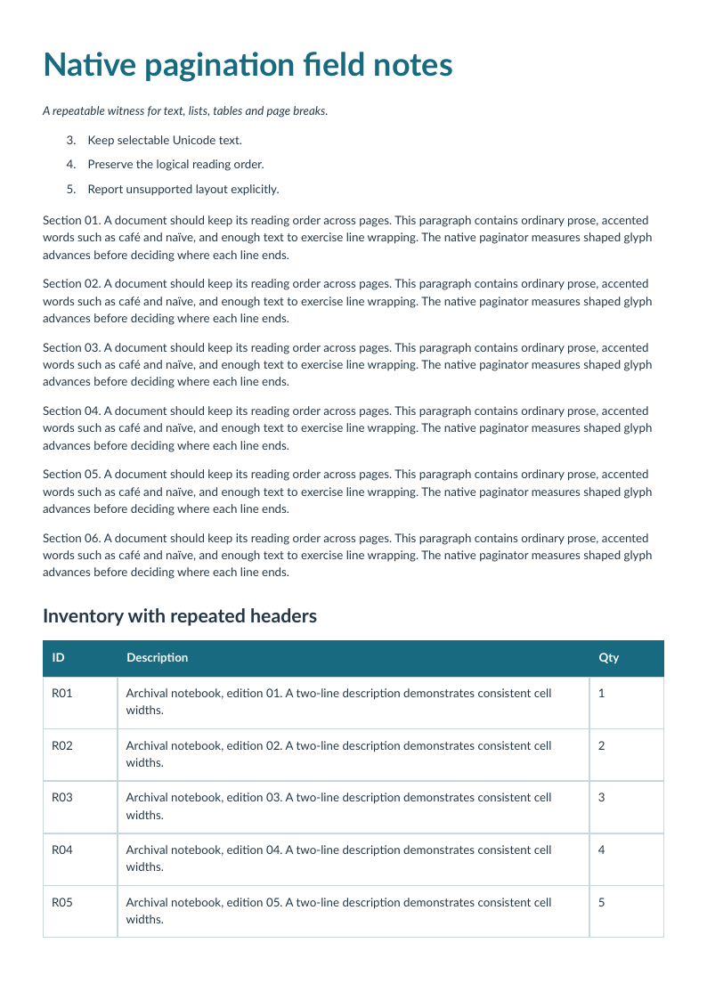

# Multiple pages: rows, reading order and forced breaks

[English](multipage.md) · [Français](fr/multipage.md)

A four-page document combines paragraphs, a numbered list, thirty inventory rows and an explicit closing-page break. Table rows remain indivisible; repeated headers are artifacts after their first occurrence.



The oracle checks all thirty records, 31 logical TR elements including the header, three logical TH elements and a closing note on the final page. Every page is rasterized and checked for unintended clipping or blank output.

[HTML source](../examples/sources/multipage.html) · [PDF download](https://github.com/PDFToolkit/html-to-pdf/releases/download/v0.2.0/multipage.pdf)

```sh
php -d memory_limit=512M examples/generate.php _build/examples
python tools/validate_pdf.py --directory _build/examples
```

This example illustrates the [documented profile](coverage.md), not a complete CSS level or PDF/UA certification.
