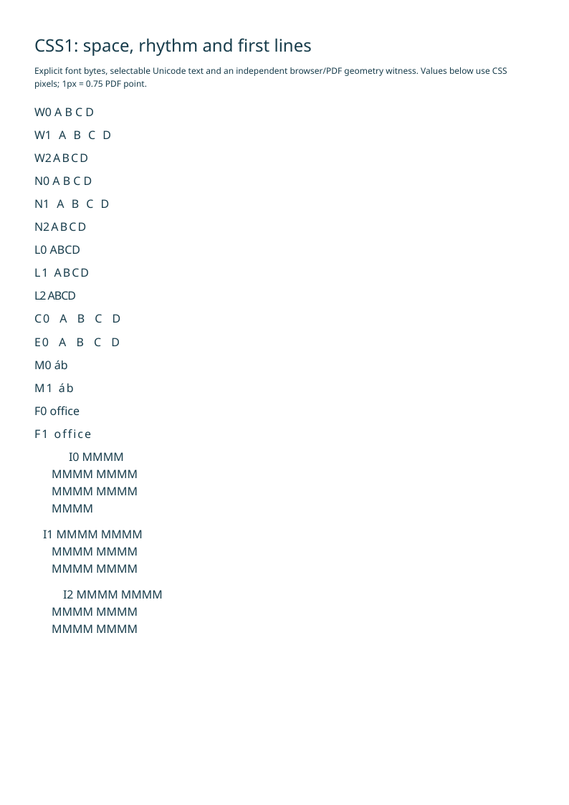
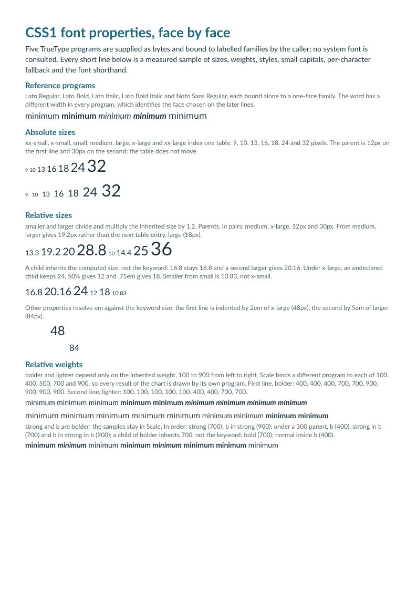

# Exemples natifs reproductibles

[English](README.md) · [Français](README.fr.md)

- [Facture](../docs/fr/invoice.md) : accents, colonnes et montants.
- [Catalogue](../docs/fr/catalogue.md) : trois images originales, retours et alternatives.
- [Plusieurs pages](../docs/fr/multipage.md) : trente lignes, en-têtes répétés comme artefacts et saut forcé.

- [Bordures CSS1](../docs/fr/css1.md#côtés-de-bordure-indépendants) : huit styles, quatre côtés indépendants et couleurs RGB.
- [Propriétés de police](../docs/fr/css1.md#propriétés-de-police) : mots-clés de taille, neuf graisses, styles, petites capitales, appariement des familles et repli par caractère.
- [Espacements et retraits](../docs/fr/css1.md#espacements-et-retrait-de-première-ligne) : longueurs signées, héritage, accents combinants et première ligne.

```sh
php -d memory_limit=512M examples/generate.php _build/examples
python tools/validate_pdf.py --directory _build/examples
```

Le générateur lit explicitement les polices/images fournies et écrit les PDF.
La bibliothèque n’effectue aucun accès fichier/réseau. Le HTML reste sous
`sources/` et les licences Lato accompagnent les polices. `tools/build_images.py`
reproduit les illustrations originales MIT.

Le manifeste conserve empreintes entrée/sortie, version PHP, diagnostics, durée
et pic mémoire. Le rapport indépendant conserve les contrôles qpdf, pypdf,
Poppler et les empreintes de toutes les pages rendues. Les artefacts de release
contiennent PDF et rapports. Les aperçus versionnés montrent la première page.

Le [cas historique CSS1 avec flottants](../docs/fr/css1.md) possède son générateur :

```sh
php -d memory_limit=512M examples/generate-w3c.php _build/w3c
python tools/validate_w3c_css1.py --pdf _build/w3c/test5526c.pdf \
  --manifest _build/w3c/manifest.json --output _build/w3c/validation
node tools/validate_w3c_css1.cjs _build/w3c/browsers
```

Sa source reste inchangée sous `resources/css1/w3c/`, avec notices BSD et
empreintes. Le manifeste identifie aussi la police de remplacement explicite et
la politique radio statique. La sortie est une page A4 exacte sans marges de page
supplémentaires ; les marges source restent appliquées. Le guide lié détaille
l’installation des navigateurs et les exclusions de l’oracle. Cet exemple ne
termine pas la qualification CSS1.

L’[exemple d’espacements](sources/text-spacing.html) fournit explicitement la
police de test Noto Sans et possède son propre générateur. Il conserve ensemble
les empreintes de source, police, PDF et validation. Exécuter la mesure navigateur
indépendante avant l’oracle PDF :

```sh
php -d memory_limit=512M examples/generate-text-spacing.php _build/text-spacing
node tools/validate_text_spacing.cjs _build/text-spacing/browser
python tools/validate_text_spacing.py --pdf _build/text-spacing/text-spacing.pdf \
  --manifest _build/text-spacing/manifest.json \
  --browser-report _build/text-spacing/browser/browser-report.json \
  --output _build/text-spacing/pdf
```



L’oracle PDF contrôle coordonnées des glyphes, Unicode et annotations de lien,
y compris la continuation native sur une nouvelle page. Les comparaisons
navigateur portent sur une page continue, sans annoncer l’équivalence de leur
pagination. Le [guide CSS1](../docs/fr/css1.md) précise installation, tests négatifs
des oracles et contextes encore absents.

L’[exemple des propriétés de police](sources/fonts.html) lit ses
[liaisons de polices](sources/fonts.json) et possède son propre générateur. Cinq
programmes TrueType fournis sont liés à des familles étiquetées, de sorte que
chaque règle d’appariement reçoit sa réponse d’un programme différent. Exécuter
la mesure navigateur avant l’oracle PDF :

```sh
php -d memory_limit=512M examples/generate-fonts.php _build/fonts
node tools/validate_fonts.cjs _build/fonts/browser
python tools/validate_fonts.py --pdf _build/fonts/fonts.pdf \
  --manifest _build/fonts/manifest.json \
  --browser-report _build/fonts/browser/browser-report.json \
  --output _build/fonts/pdf
```



L’oracle PDF identifie chaque programme incorporé, puis contrôle face, corps,
glyphes, avances et texte Unicode de chaque fragment mesuré. Le
[guide CSS1](../docs/fr/css1.md#propriétés-de-police) précise l’installation et
énumère les sept écarts affirmés et ce que l’oracle ne couvre pas.
