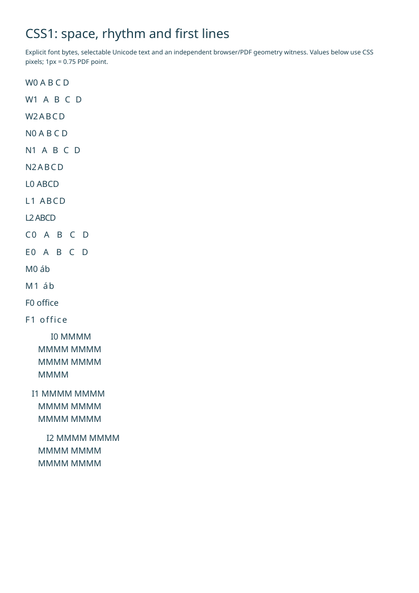
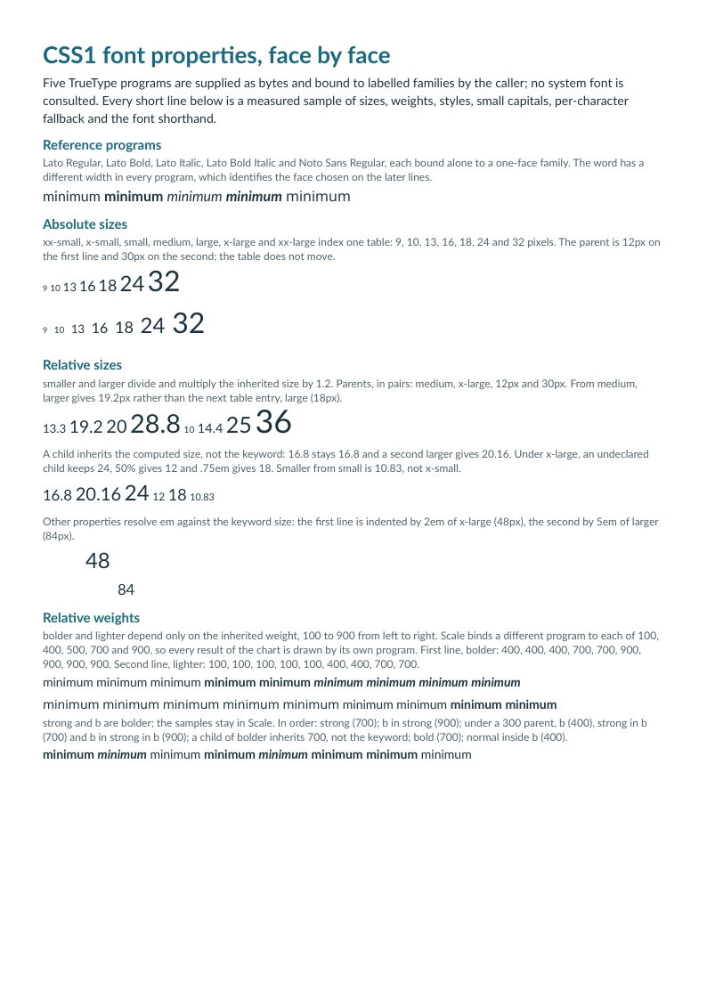

# Reproducible native examples

[English](README.md) · [Français](README.fr.md)

- [Invoice](../docs/invoice.md): accented text, columns and totals.
- [Catalogue](../docs/catalogue.md): three original images, wrapping and alternatives.
- [Multiple pages](../docs/multipage.md): thirty rows, repeated header artifacts and forced break.

- [CSS1 borders](../docs/css1.md#independent-border-sides): eight styles, four independent sides and RGB colors.
- [Font properties](../docs/css1.md#font-properties): size keywords, nine weights, styles, small capitals, family matching and character fallback.
- [Text spacing and indentation](../docs/css1.md#text-spacing-and-first-line-indentation): signed lengths, inherited styles, combining marks and first-line behavior.

```sh
php -d memory_limit=512M examples/generate.php _build/examples
python tools/validate_pdf.py --directory _build/examples
```

The generator explicitly reads bundled fonts/images and writes PDF bytes. The
library itself performs no file/network access. Source HTML remains under
`sources/`; Lato licenses are retained beside the fonts. `tools/build_images.py`
reproduces the original MIT illustrations.

The generated manifest records input/output hashes, PHP version, diagnostics,
time and peak memory. The independent report records qpdf, pypdf and Poppler
checks and hashes for every page render. Release assets contain the PDFs and
validation reports. The committed previews show the first page of each example.

The [historical CSS1 float case](../docs/css1.md) has a separate generator:

```sh
php -d memory_limit=512M examples/generate-w3c.php _build/w3c
python tools/validate_w3c_css1.py --pdf _build/w3c/test5526c.pdf \
  --manifest _build/w3c/manifest.json --output _build/w3c/validation
node tools/validate_w3c_css1.cjs _build/w3c/browsers
```

Its source is preserved unchanged under `resources/css1/w3c/`, with BSD notices
and hashes. The manifest also identifies the explicit fallback font and static
radio policy. The output is one exact A4 page with zero additional page margins;
source margins remain in effect. See the linked guide for browser setup and the
precise oracle exclusions. This example does not complete CSS1 qualification.

The [text spacing example](sources/text-spacing.html) uses the explicit Noto Sans
test face and a separate generator. It keeps the source, font, PDF and validation
hashes together. Run the independent browser measurement before the PDF oracle:

```sh
php -d memory_limit=512M examples/generate-text-spacing.php _build/text-spacing
node tools/validate_text_spacing.cjs _build/text-spacing/browser
python tools/validate_text_spacing.py --pdf _build/text-spacing/text-spacing.pdf \
  --manifest _build/text-spacing/manifest.json \
  --browser-report _build/text-spacing/browser/browser-report.json \
  --output _build/text-spacing/pdf
```



The PDF oracle checks glyph coordinates, Unicode and link annotations, including
native page continuation. Browser comparisons concern continuous-page geometry,
not browser pagination equivalence. The [CSS1 guide](../docs/css1.md) explains
setup, negative oracle tests and remaining unsupported contexts.

The [font properties example](sources/fonts.html) reads its
[font bindings](sources/fonts.json) and has its own generator. Five supplied
TrueType programs are bound to labeled families so that each matching rule is
answered by a different program. Run the browser measurement before the PDF
oracle:

```sh
php -d memory_limit=512M examples/generate-fonts.php _build/fonts
node tools/validate_fonts.cjs _build/fonts/browser
python tools/validate_fonts.py --pdf _build/fonts/fonts.pdf \
  --manifest _build/fonts/manifest.json \
  --browser-report _build/fonts/browser/browser-report.json \
  --output _build/fonts/pdf
```



The PDF oracle identifies each embedded program, then checks the face, size,
glyphs, advances and Unicode text of every measured fragment. The
[CSS1 guide](../docs/css1.md#font-properties) explains setup and lists the seven
asserted deviations and what the oracle does not cover.
